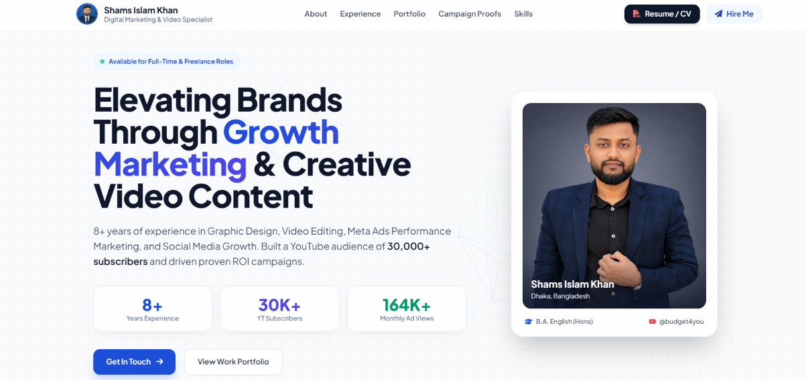

# 🚀 3D Interactive Client Portfolio Website

An executive-grade, highly responsive, single-file 3D portfolio website designed and custom-built for a client (**Shams Islam Khan**) specializing in Digital Marketing, Video Editing, and Motion Graphics.

This project was built to deliver a top-tier visual experience tailored to client specifications, incorporating white-theme glassmorphism, 3D tilt effects, interactive lightboxes, live video player modals, and seamless lead generation.

---

## 📌 Project Preview

> **Project Status:** Completed & Handed Over to Client  
> **Architecture:** Single-file HTML / CSS (Tailwind CDN) / JavaScript (Vanilla JS & Three.js)

---

## ✨ Key Features & Deliverables

- **3D Canvas & Parallax Animation:** Powered by **Three.js** with non-intrusive interactive geometric shapes that react to mouse movements.
- **Floating 3D Tilt Cards:** Micro-tilt animations on highlight statistics, professional profile cards, and work experience showcases.
- **Categorized Video & Motion Portfolio:** Embedded YouTube modal previews and Direct Reels integration for marketing campaign ads and motion graphics showcases.
- **Client Performance Analytics Section:** Dedicated section highlighting real social media growth metrics (Instagram Insights, Facebook Ads ROI, Audience Demographics) with high-res lightbox modals.
- **Formspree Direct Email Integration:** AJAX-powered contact form (`fetch` API) providing real-time submission notifications (`✓ Message Sent`) without page reloading or external redirects.
- **One-Click PDF Resume Access:** Direct integration to view and download the official client CV (`/image/shamsislamkhan_cv.pdf`) in a new browser tab.
- **100% Device Responsive:** Pixel-perfect layout optimization across Mobile, iOS, Android, Tablets, iPads, and Laptops.

---

## 🛠️ Tech Stack & Libraries

- **Markup & Styling:** HTML5, Tailwind CSS (via CDN)
- **Icons & Typography:** FontAwesome 6, Google Fonts (Plus Jakarta Sans)
- **3D Graphics & Parallax:** Three.js (WebGL renderer)
- **Form Service:** Formspree API (AJAX Fetch Integration)

---

## 💼 Client Handover Note

This repository contains the full source code delivered to the client. All component configurations, form endpoints, assets, and responsive viewports have been fully tested and validated for live production deployment (Netlify / Vercel / GitHub Pages).